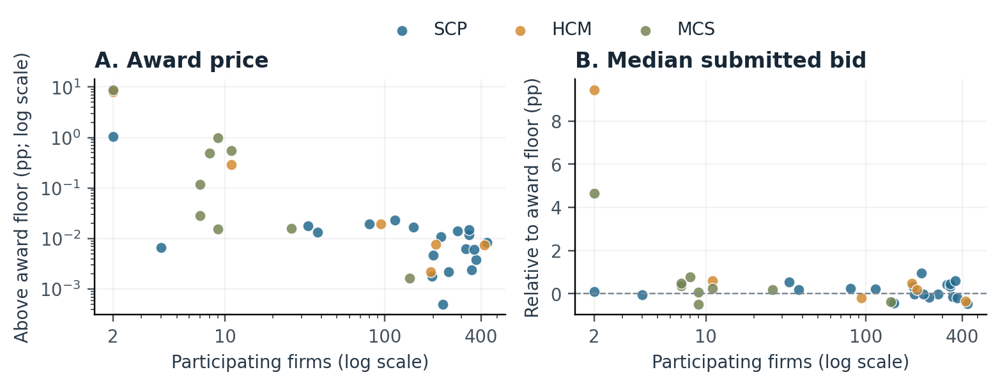

# Bid Participation and Price Distribution in Military Food Procurement

An Exploratory Study

Independent research paper | South Korea | 2024-2025 tender openings | 12 October 2026 | Revised 18 October 2026

## Abstract

This study examines whether greater bid participation is associated with lower award prices and a downward shift in submitted bid prices. It analyzes 35 awarded military food-procurement tenders from three South Korean purchasing agencies, comprising 5,458 bid records and 845 distinct business identifiers. Prices are expressed as percentage-point differences from each tender's award-floor rate. Participation is strongly negatively associated with the award-price gap (Spearman rho = -0.709), but less strongly with the median submitted-bid gap (rho = -0.312). After accounting for agency, floor rate, base amount and opening year, the corresponding partial rank correlations are -0.503 and -0.152. Fixed-size subset diagnostics and five awards exceeding the lowest ranked, nonexcluded price complicate a simple competition narrative. A paired soy-sauce case reveals changes in listed license restrictions. The findings support an association between participation and awards near the floor, without identifying savings or a causal change in firms' pricing behavior.

## 1. Research question and motivation

More bidders are often expected to strengthen price competition. However, a low winning price can also arise simply because a higher number of bids increases the chance of a price close to the award threshold, even without any change in how firms price. Comparing participant counts with award amounts alone can therefore conflate participation, price-distribution and selection effects.

The question is: within this sample, how does bid participation relate to the distribution of submitted prices and the eventual award price? The study separates these outcomes and investigates exceptions. Its benchmark is a tender-specific award floor, not a market valuation of the goods or an estimate of government savings.

## 2. Data and scope

The sample was collected from food-purchase notices at Unit 8385 (SCP; 20 tenders), the Air Force Education and Training Command (HCM; 6), and the Gyeryongdae Service Support Group (MCS; 9). Fourteen tenders opened in 2024 and 21 in 2025. Opening year is distinguished from the API demand-year identifier. The working scope retained awarded food purchases under total-price bidding and qualification review; it excluded services, failed awards and ambiguous mixed purchases. It is not a probability sample or a census of national procurement.

## Research and tool contribution disclosure

The researcher led the inquiry, accessed the public portal, executed collection scripts, supplied saved responses, and reviewed the findings. ChatGPT supported code generation, data reconciliation, statistical calculations, figure preparation and English drafting. The researcher did not independently write all code or perform all calculations. This paper reports exploratory findings; use of tools should be disclosed in accordance with the recipient institution's requirements.

## 3. Measurement and verification

Data were collected through the Defense Acquisition Program Administration's public Bid Results API [1]. The 35 bidder CSVs were checked against 78 cached XML response pages across eight fields: business identifier, company code, bid amount, displayed rate, rank, result marker, note and submission time. Reported page numbers, totals and tender-level record counts matched. Identical duplicate file copies were counted once. This verifies the saved data internally; it does not establish that the original source system was never revised.

Each tender had four selected preliminary prices and one marked award. Let E be the arithmetic mean of the four selected prices, truncated below one won, and L the tender's award-floor rate in percent. For bid amount A, the normalized gap is:

g = 100 x A / E - L  (percentage points)

This reconstruction follows the rounding convention in Article 16 of the 2025 electronic-bidding rules [3], instead of using an independent estimate sheet for each tender. Unrounded, truncated, rounded-up and nearest-won variants produced the same overall award-gap rank correlation. Negative gaps identify prices below the floor; they do not measure savings. The denominator is the reconstructed estimate, not the budget or base amount.

Participation is the number of distinct business identifiers per tender, which equaled the submitted-record count in all 35 cases. Each tender contributes one observation. Full-distribution medians include all submitted prices, including excluded bids. A separate ranked subset requires a displayed numeric rank or award marker and excludes notes labeled invalid, below-floor or above-estimate. It does not establish final qualification. There were 2,466 below-floor labels, 126 invalid labels, 13 above-estimate labels and 2,853 ranked, nonexcluded records.

Figure 1. One point per tender, colored by agency. Both horizontal axes are logarithmic. The award-gap vertical axis is also logarithmic; the median-bid vertical axis is linear and can be negative. These different scales must not be compared visually as effect sizes.

## 4. Descriptive results and sensitivity

Table 1 compares participation with several tender-level price summaries. The association is strongest for final award prices and weaker for the middle of the submitted-price distribution. Removing invalid submissions barely changes the median result. Thus the award association should not be read as equally strong evidence that the typical submitted offer declines with participation.

Table 1. Participation and price gaps (35 tenders).
| Tender-level price measure | Spearman rho | Partial rank r |
| --- | --- | --- |
| Award gap | -0.709 | -0.503 |
| Minimum ranked, nonexcluded gap | -0.662 | -0.424 |
| Median of all submitted gaps | -0.312 | -0.152 |
| Median excluding invalid labels | -0.321 | -0.152 |
| Median ranked, nonexcluded gap | -0.421 | -0.365 |

Partial rank correlations were calculated by first converting participation and each outcome to average ranks. Each set of ranks was separately regressed on an intercept, agency indicators, an 87.995% floor indicator, base-amount rank and opening-year indicator. The residuals were then correlated. These are small-sample descriptive adjustments, not estimates of the effect of adding a bidder. Product mix, eligibility, location, quantity and recurring bidder composition remain unaccounted for.

Eleven tenders with fewer than 20 participants had a median award gap of 0.489 percentage points, compared with 0.008 among 24 tenders with at least 20 participants. This threshold was chosen for illustration after looking at the data, not as a preset policy cutoff. Leaving out any single tender kept the award-gap correlation negative, ranging from -0.768 to -0.683. The negative association therefore does not depend on one unusual tender.

## 4.1 Holding the number of observed offers fixed

For each tender with N ranked, nonexcluded records, the analysis calculates the exact expected minimum when m records are selected uniformly without replacement. For sorted gap g_j, indexed from zero, its probability of being the subset minimum is C(N-j-1,m-1)/C(N,m). This avoids simulation noise and compares the same number of observed offers per tender.

Table 2. Fixed-size subset diagnostic; explanatory count is N.
| m | Tenders | N vs. actual award | N vs. subset minimum |
| --- | --- | --- | --- |
| 2 | 32 | -0.679 | -0.105 |
| 5 | 30 | -0.610 | +0.406 |
| 10 | 25 | -0.386 | +0.675 |

The original strong negative relationship is not reproduced by these standardized minima. This is compatible with opportunity-count and distribution-selection effects. It does not isolate them causally: the records were already submitted, ranked-subset membership depends on price and status, and the sample changes with m. Firms' responses to an actual reduction in competitors are not modeled.

## 5. Award selection and a notice-level case

In five tenders, the final award price was higher than the lowest ranked, nonexcluded price. Four awards were marked second rank, and one was marked ninth. The observed difference should not be called waste or attainable savings, because the lower bidder's ability and willingness to perform are unknown.

Table 3. Awards above the lowest ranked, nonexcluded price.
| Opening date / notice | Award rank | Amount difference (KRW) |
| --- | --- | --- |
| 2024-01-26 / SCP0005 | 2 | 37,408 |
| 2024-02-27 / SCP0023 | 2 | 11,030 |
| 2024-08-19 / MCS0100 | 9 | 336,000 |
| 2025-01-13 / SCP0132 | 2 | 24,911 |
| 2025-03-18 / MCS0027 | 2 | 11,275,958 |

MCS0027 is especially informative. Its two submitted prices included a ranked offer of KRW 120,742,242 and an award of KRW 132,018,200. Their normalized gaps were 0.526 and 8.793 percentage points. About 94% of the award gap comes from the difference between these two observed prices. Assuming both firms simply bid far above the floor would miss the lower offer. The API does not explain why it was not chosen.

Excluding all five cases leaves 30 tenders and an award-gap correlation of -0.662, or -0.464 after the same adjustment. Selection differences alone therefore do not explain the overall association. Still, dropping cases based on award outcomes is selective and should not be treated as a guarantee of causal robustness.

## 5.1 Soy-sauce notices: similar names, different conditions

The Bid Notices API [2] provides additional metadata for two Unit 8385 notices for mixed soy sauce and three other items. Both opened in 2025, although SCP0133 has a 2024 demand-year identifier. Participation dropped from 197 to 4, with only one business identifier appearing in both. Their award-floor rate stayed at 87.995%.

Table 4. Conditions displayed in the two soy-sauce notices.
| Field | SCP0133 (Jan. 2025) | SCP0107 (Dec. 2025) |
| --- | --- | --- |
| Competition method | General | Restricted |
| Listed license categories | 5 | 1 |
| Inspection / assurance label | Demanding-service inspection | Simple quality assurance (Type I) |
| Budget amount (KRW) | 48,720,000 | 67,436,000 |
| Delivery deadline | 2025-12-30 | 2026-12-15 |

The later notice lists only food sales to institutional catering facilities, while the earlier list also includes manufacturing/processing, repackaging and other food-sales categories. The API does not show whether these were alternative or joint requirements, nor does it split the procurement bundle into four separate food quantities or specifications. This eligibility change is a point for further study, not proof that it excluded 193 firms. Both awards stayed close to the floor, about 0.00178 and 0.00670 percentage points above it.

## 6. Interpretation, limits and next questions

The evidence distinguishes three stages: the set of firms that participate, the prices they submit, and the choice of final contractor. More participation is associated with awards near the floor, but the central submitted price has a weaker relationship, especially after descriptive adjustment. Fixed-size subset minima do not preserve the original pattern, while award-selection exceptions and changing notice conditions demonstrate why counts alone are insufficient.

The main takeaway is about measurement: an award-price association should not automatically become a claim about firms lowering prices or government saving money. An award floor is an administrative benchmark. A budget-to-award difference can also reflect different quantities, estimated costs or contract conditions, none of which are held constant here.

The study is limited by a purpose-selected sample of 35 awarded tenders from only three agencies. Repeated agencies, products and bidders create dependence; 5,458 records are not 5,458 independent tenders. Failed or ambiguous purchases were excluded, so the results do not describe all procurement outcomes. Analysis choices, cutoffs and case selection were not preregistered. No hypothesis-testing claim or population-wide effect size is made.

Bidder-level qualification decisions and the reasons for five selection exceptions remain unverified. Detailed product quantities, grades, origins, delivery schedules and special contract terms were not obtained. The soy-sauce notices show metadata differences but cannot support a like-for-like unit-price comparison. Instead of just gathering more similar data, future research should focus on original notice attachments and award-decision records.

## 7. Conclusion

This exploratory sample shows a negative relationship between bid participation and the final award's distance from its floor. The relationship survives descriptive adjustments and the exclusion of five award-selection exceptions, but it is much weaker at the center of the submitted-price distribution. These findings show why eligibility, price distributions and contractor selection should be examined together, while leaving causal competition effects and budget savings as open questions.

## Data, code and references

The accompanying reproduction package contains 35 tender records, 5,458 curated bid records, opaque consistent bidder labels, the analysis script, figures, outputs and source-file checksums. It excludes API credentials, business names, original business identifiers and staff contacts, though tender-price combinations may still be linkable to public records. Data definitions and reproduction instructions are provided in the repository's DATA_DICTIONARY.md and README.md.

[1] Defense Acquisition Program Administration. Bid Results Information_GW. Public Data Portal, dataset 15158417. https://www.data.go.kr/data/15158417/openapi.do

[2] Defense Acquisition Program Administration. Bid Notices Information_GW. Public Data Portal, dataset 15158416. https://www.data.go.kr/data/15158416/openapi.do

[3] Defense Acquisition Program Administration. Special Instructions for Electronic Bidding, Article 16; effective 16 April 2025. National Law Information Center. https://www.law.go.kr/LSW/admRulInfoP.do?admRulSeq=2100000257968

Sources accessed during collection and verification, 9-12 October 2026. The dated source archives remain with the researcher, and checksums identify the exact supplied versions.
